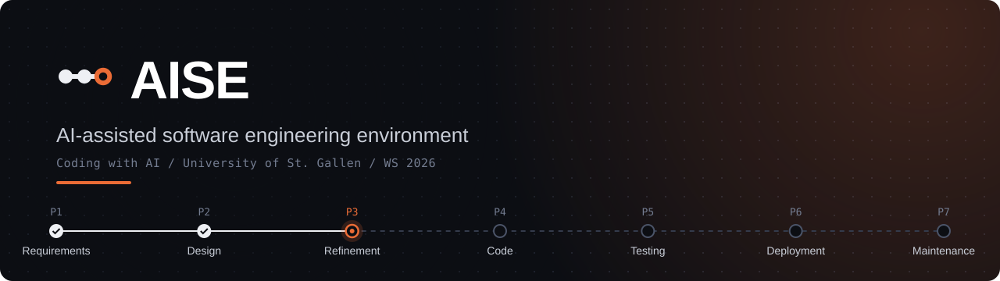

<p align="center">
  
</p>

<p align="center">
  <a href="https://github.com/Benjam1nP/AI_Project/actions/workflows/ci.yml"></a>
  
  
  
  
  
  
  
</p>

# AISE

AI-assisted software engineering environment, a group project for "Coding with AI" (University of St. Gallen, WS 2026). A multi-agent system guides a developer through requirements, design, code, tests, deployment and maintenance. At every phase the developer sees, discusses and changes the output before the system moves on.

| Phase                | Status | What it does                                                                                               |
| -------------------- | ------ | ---------------------------------------------------------------------------------------------------------- |
| P1 Requirements      | built  | Turns a vague description into structured requirements, asks instead of guessing                           |
| P2 Design            | built  | Use case, class, sequence and deployment diagrams from approved requirements                               |
| P3 Design refinement | built  | A review agent proposes design improvements; Accept, Reject or Discuss, accepted ones update every diagram |
| P4 Code generation   | built  | Code from the approved design, one file per class, gated by typecheck and drift                            |
| P5 Testing           | built  | One test file per use case, one test per criterion, run in a locked down container, failures triaged       |
| P6 Deployment        | built  | Dockerfile, compose.yaml and RUN.md from the design, checked by starting the stack in Docker               |
| P7 Maintenance       | built  | Every change goes through a ticket: triage, plan, the phases with their gates, a change report             |

The agents are in [ARCHITECTURE.md](ARCHITECTURE.md): Sonnet 5.5 for requirements, design, design review (P3 proposals), code wiring, test triage and deployment, Haiku 5.5 for the file workers, Opus 5.5 (medium effort) for maintenance.

**P4 in short.** Approving the design starts code generation. Plain code plans one file per design class (`src/<component>/<Class>.ts`); Haiku workers write the files in parallel rounds, a type check and a drift check against the design decide which are done, failing files retry and the third attempt runs on Sonnet. A Sonnet code agent then writes the Express wiring in `src/app/` and a small page in `public/`. The gate shows typecheck and drift, goes out of date after a hand edit or a design change, and P4 turns stale when the design changes (Update or Still valid). The Code tab shows the files read only. The agents are listed in [ARCHITECTURE.md](ARCHITECTURE.md#agents).

**P5 in short.** Approving the code starts test generation. Plain code plans one test file per use case; every acceptance criterion becomes a test titled `REQ-001 AC2: ...`, so each criterion traces to a test and its last result. Haiku workers write the files in parallel rounds, one typecheck and test run decide which are done, a file retries only for a tsc error, a file that does not load or a criterion without a test (the third attempt runs on Sonnet). Tests are written from requirements, design and the code's API (`code_model`), never from `src/` bodies. A Sonnet test agent then triages each failing test: a test that contradicts the requirements or API it fixes and records, a failure the code causes becomes a finding with an explanation and a proposed fix, and any test it changed without reporting is recorded automatically. Apply fix hands a finding to the code agent; Run tests re-runs the suite without an LLM, and Explain failures runs the triage on failing tests that have no finding yet (after a hand edit), so the demo goes hand edit, Run tests, Explain failures, Apply fix, green. The gate shows tests exist, every must criterion has a test, typecheck and results, goes out of date after a hand edit, and P5 turns stale when a requirement or use case changes.

**P6 in short.** Approving the tests starts the deploy agent (Sonnet, medium effort). Plain code derives the plan from the design and `package.json`: one compose service per service node with its start script, port, peer URLs and a shared data volume, plus a literal placeholder for every other `process.env` variable the code reads. The agent writes `Dockerfile`, `compose.yaml` and `RUN.md` and proves them with `deploy_check`, which starts the stack and probes every health URL (at most 3 checks and $1 per run). The Deploy tab shows the three files, the last check per service with its log tail, and Run deploy check re-runs it without an LLM. The gate shows the files exist, compose.yaml matches the plan and the stored check passed on the current files; it goes out of date after a hand edit, and P6 turns stale when the service nodes, their links, start scripts or dependencies change. The generated project `README.md` links to `RUN.md`.

**P7 in short.** Every change to a finished project is a ticket (change, requirement, bug or drift) in the Tickets tab, with its own chat. The maintenance agent (Opus 5.5, medium effort: it reasons over all artefacts at once to find what a change touches) reads the requirements, design, code and tests, asks at most three questions, then writes a plan: the phase where the change starts, the affected IDs and files, and the steps. When you approve the plan, the agent of that phase makes the change and the staleness cascade marks the later phases stale; you Update or confirm each one and approve it, as in any phase. Closing the ticket stores a change report: the runs, a diff per file, the changed IDs, the last test result and a short summary by the agent. Code that differs from the design can be turned into a drift ticket from the Code tab, repaired in either direction. The agent never edits a file; its only writes are the plan and the report.

**Agent communication.** Agents do not call each other; the orchestrator, which is plain code, passes work between them. Between phases the agents share files: the requirements and design documents, the code, the tests and the findings. The one place where two agents talk is the P5 fix loop. The test agent records a code bug with `report_code_bug`; plain code hands the open findings to the code agent as a fix brief (the test, its file and its failure); the code agent patches `src/` and answers each finding with `report_fix_result` (fixed, needs a design change, or the test looks wrong); the P4 and P5 checks run; then the test agent triages again what still fails and any test the code agent disputes. The loop stops when the tests are green, nothing is left to hand over, a round changes no file, after 3 rounds or at a $3 cost guard, and a test gets at most 2 fix attempts. It starts from the Fix automatically button in the Tests tab and by itself after test generation leaves an open code bug, so approving P4 can spend up to $2 for the tests plus $3 for the loop without another click. Every handoff is shown as a message between the two agents, in the live run and in the P5 chat ("Test agent to Code agent"), and is kept in the run's `events.jsonl`. Discard last run undoes the whole loop.

## Getting started

```bash
npm ci
cp .env.example .env   # add ANTHROPIC_API_KEY
npm run dev            # http://localhost:5173
```

Requires Node 22.9 or newer (`--env-file-if-exists`). Docker is needed from P4 on: generated code is type checked, tested and deployed only inside containers. `.env.example` sets `HOST=127.0.0.1`, so `npm start` (after `npm run build`) listens on this machine only; the server spends API credit and writes files, so do not expose it to the network.

### Before a demo

Deploy checks publish the generated stack on `127.0.0.1:8080` (and 8081 and up), so stop any other stack on those ports first (`docker ps`). Each rebuild leaves the old image behind; run `docker image prune` now and then.

## Common commands

```bash
npm run check          # svelte-kit sync and svelte-check (warnings fail)
npm run lint           # Prettier and ESLint
npm test               # Vitest: node and jsdom projects
npm run test:docker    # tests against real containers (needs Docker)
npm run mcp -- --project <dir> [--agent <name>]
npx tsx scripts/smoke-p7.ts   # live ticket run, costs API credit (up to $6), needs Docker, not in CI
```

CI runs all four plus a secret scan (gitleaks) and `npm audit`. `/dev/ui` (dev server only) shows every design system component and token.

## MCP server

`npm run mcp` serves one project's tools over stdio; `.mcp.json` points Claude Code at `showcases/todo`. To inspect: `npx @modelcontextprotocol/inspector npx tsx src/lib/server/mcp/main.ts --project <dir>`.

Tools: `read_requirements`, `write_requirements`, `read_design`, `update_design`, `report_coverage`, `list_files`, `read_file`, `write_file`, `delete_file`, `code_model`, `detect_drift`, `typecheck`, `run_tests`, `start_app`, `deploy_check`, `read_tickets`, `trace`. Our own agents call the same tools in process. Writes over MCP are recorded as a P7 run with backups but skip the phase gates. Discard of a P7 run (an MCP write, a ticket triage or a close) works through the orchestrator but has no button in the UI yet.

`.mcp.json` also lists 21st.dev and Originkit for UI reference during development; they read `TWENTYFIRST_API_KEY` and `ORIGIN_KIT_KEY` from `.env` and are not part of the product.

## Documentation

- [ARCHITECTURE.md](ARCHITECTURE.md): agents, tools, orchestrator, event flow (living)
- [docs/superpowers/specs/2026-11-04-ai-se-environment-design.md](docs/superpowers/specs/2026-11-04-ai-se-environment-design.md): the frozen design
- [AGENTS.md](AGENTS.md): every command and convention (also read by coding agents)
- [CHANGELOG.md](CHANGELOG.md), [docs/decisions.md](docs/decisions.md), [docs/design-system.md](docs/design-system.md)
- [docs/context/INDEX.md](docs/context/INDEX.md): course material and requirements as Markdown
