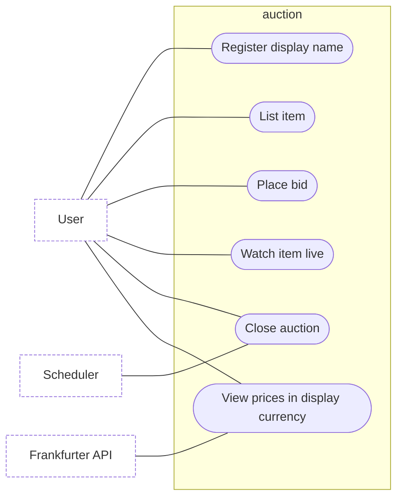
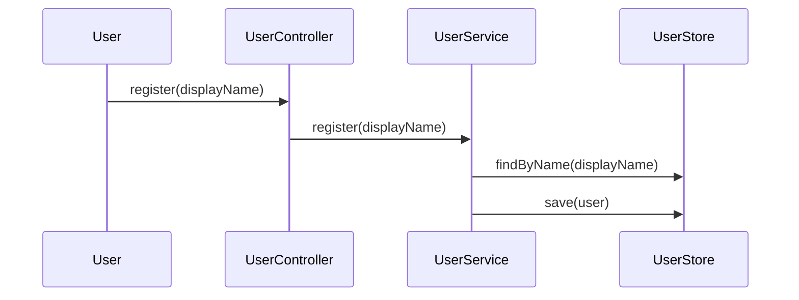
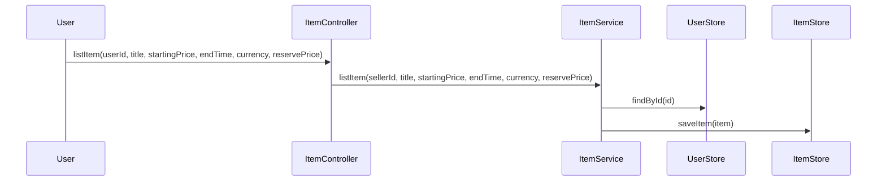
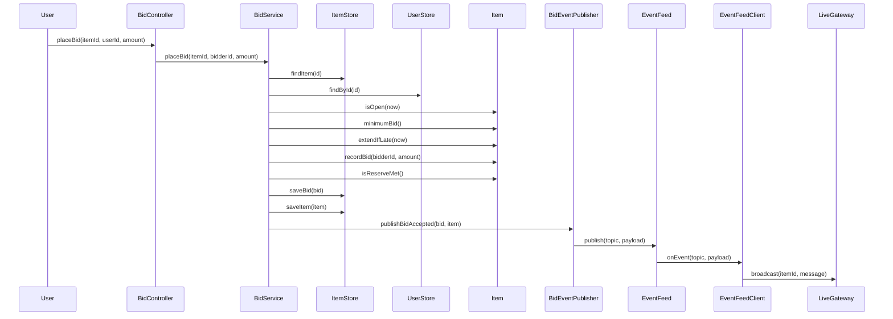
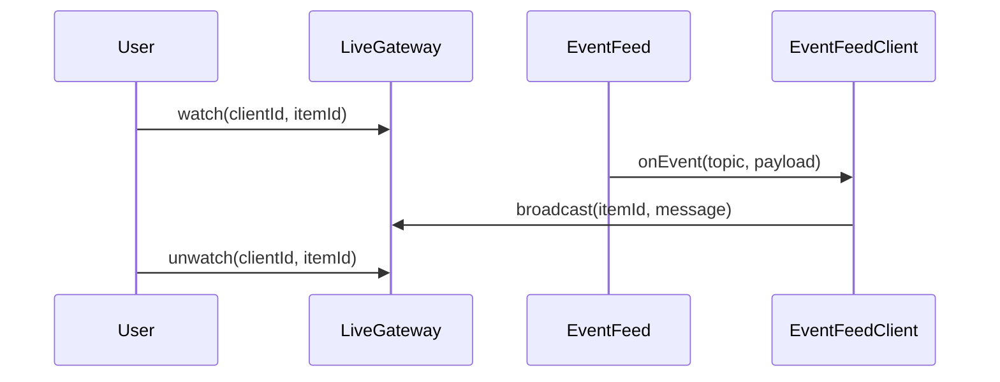
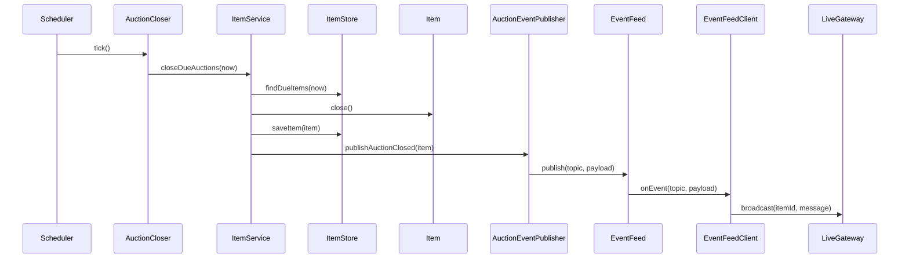
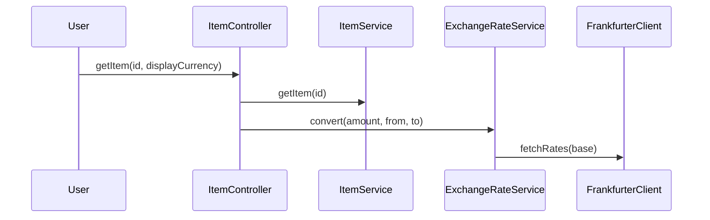
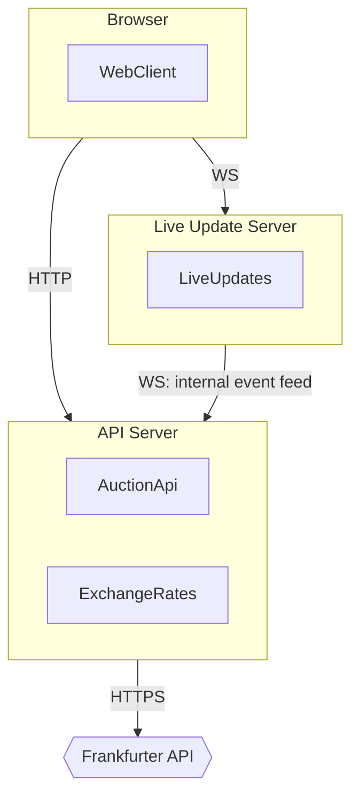

<!-- generated by AISE from .aise/*.json, do not edit -->

# auction: design

## Use cases

## Classes

```mermaid
classDiagram
  class Currency {
    <<enumeration>>
    CHF
    EUR
    USD
  }
  class AuctionStatus {
    <<enumeration>>
    open
    closed
    unsold
  }
  class User {
    +id : string
    +displayName : string
  }
  class Item {
    +id : string
    +sellerId : string
    +title : string
    +startingPrice : number
    +reservePrice : number | null
    +currency : Currency
    +endTime : Date
    +status : AuctionStatus
    +highestBidAmount : number | null
    +highestBidderId : string | null
    +winnerId : string | null
    +isOpen(now: Date) boolean
    +minimumBid() number
    +extendIfLate(now: Date) boolean
    +recordBid(bidderId: string, amount: number) void
    +isReserveMet() boolean | null
    +close() void
  }
  class Bid {
    +id : string
    +itemId : string
    +bidderId : string
    +amount : number
    +placedAt : Date
  }
  class ItemView {
    <<interface>>
    +item : PublicItem
    +displayCurrency : Currency | null
    +convertedStartingPrice : number | null
    +convertedHighestBid : number | null
  }
  class PublicItem {
    <<interface>>
    +id : string
    +sellerId : string
    +title : string
    +startingPrice : number
    +currency : Currency
    +endTime : Date
    +status : AuctionStatus
    +highestBidAmount : number | null
    +highestBidderId : string | null
    +winnerId : string | null
    +reserveMet : boolean | null
  }
  class UserController {
    +register(displayName: string) Promise~User~
  }
  class ItemController {
    +listItem(userId: string, title: string, startingPrice: number, endTime: string, currency: string, reservePrice: number | null) Promise~PublicItem~
    +getItem(id: string, displayCurrency: string | undefined) Promise~ItemView~
    +listOpenItems() Promise~PublicItem[]~
  }
  class BidController {
    +placeBid(itemId: string, userId: string, amount: number) Promise~Bid~
  }
  class UserService {
    +register(displayName: string) Promise~User~
  }
  class ItemService {
    +listItem(sellerId: string, title: string, startingPrice: number, endTime: Date, currency: string, reservePrice: number | null) Promise~PublicItem~
    +getItem(id: string) Promise~PublicItem~
    +listOpenItems() Promise~PublicItem[]~
    +closeDueAuctions(now: Date) Promise~void~
  }
  class BidService {
    +placeBid(itemId: string, bidderId: string, amount: number) Promise~Bid~
  }
  class AuctionCloser {
    +intervalMs : number
    +tick() Promise~void~
  }
  class ExchangeRateService {
    +cacheTtlMs : number
    +convert(amount: number, from: Currency, to: Currency) Promise~number | null~
  }
  class FrankfurterClient {
    +fetchRates(base: Currency) Promise~Record~string, number~~
  }
  class UserStore {
    +findByName(displayName: string) Promise~User | null~
    +save(user: User) Promise~User~
    +findById(id: string) Promise~User | null~
  }
  class ItemStore {
    +saveItem(item: Item) Promise~Item~
    +findItem(id: string) Promise~Item | null~
    +findOpenItems() Promise~Item[]~
    +findDueItems(now: Date) Promise~Item[]~
    +saveBid(bid: Bid) Promise~Bid~
  }
  class AuctionEventPublisher {
    +publishAuctionClosed(item: Item) Promise~void~
  }
  class BidEventPublisher {
    +publishBidAccepted(bid: Bid, item: Item) Promise~void~
  }
  class EventFeedClient {
    +connect() void
    +onEvent(topic: string, payload: string) void
  }
  class LiveGateway {
    +sockets : Map~string, WebSocket~
    +watch(clientId: string, itemId: string) void
    +unwatch(clientId: string, itemId: string) void
    +broadcast(itemId: string, message: string) void
  }
  class EventFeed {
    +clients : Set~WebSocket~
    +publish(topic: string, payload: string) void
  }
  Item --> "1" User : seller
  Item --> Currency
  Item --> AuctionStatus
  Bid --> "0..*" Item
  Bid --> "1" User : bidder
  ItemView --> PublicItem
  PublicItem --> Currency
  PublicItem --> AuctionStatus
  UserController ..> UserService
  ItemController ..> ItemService
  ItemController ..> ExchangeRateService
  BidController ..> BidService
  UserService ..> UserStore
  ItemService ..> ItemStore
  ItemService ..> UserStore
  ItemService ..> AuctionEventPublisher
  BidService ..> ItemStore
  BidService ..> BidEventPublisher
  BidService ..> UserStore
  AuctionCloser ..> ItemService
  ExchangeRateService ..> FrankfurterClient
  ItemStore --> "0..*" Item
  ItemStore --> "0..*" Bid
  AuctionEventPublisher ..> EventFeed
  BidEventPublisher ..> EventFeed
  EventFeedClient ..> LiveGateway
  click Currency call aiseSelect("DSN-012")
  click AuctionStatus call aiseSelect("DSN-013")
  click User call aiseSelect("DSN-014")
  click Item call aiseSelect("DSN-015")
  click Bid call aiseSelect("DSN-016")
  click ItemView call aiseSelect("DSN-017")
  click PublicItem call aiseSelect("DSN-044")
  click UserController call aiseSelect("DSN-018")
  click ItemController call aiseSelect("DSN-019")
  click BidController call aiseSelect("DSN-020")
  click UserService call aiseSelect("DSN-021")
  click ItemService call aiseSelect("DSN-022")
  click BidService call aiseSelect("DSN-023")
  click AuctionCloser call aiseSelect("DSN-024")
  click ExchangeRateService call aiseSelect("DSN-025")
  click FrankfurterClient call aiseSelect("DSN-026")
  click UserStore call aiseSelect("DSN-028")
  click ItemStore call aiseSelect("DSN-029")
  click AuctionEventPublisher call aiseSelect("DSN-030")
  click BidEventPublisher call aiseSelect("DSN-031")
  click EventFeedClient call aiseSelect("DSN-032")
  click LiveGateway call aiseSelect("DSN-033")
  click EventFeed call aiseSelect("DSN-034")
```

## Sequences

### SEQ-001 Register display name

### SEQ-002 List item

### SEQ-003 Place bid

### SEQ-004 Watch item live

### SEQ-005 Close auction

### SEQ-006 View prices in display currency

## Deployment

## Elements

- ACT-001 User (actor)
- ACT-002 Frankfurter API (actor)
- ACT-003 Scheduler (actor)
- UC-001 Register display name (use case) (REQ-008)
- UC-002 List item (use case) (REQ-001, REQ-008, REQ-012)
- UC-003 Place bid (use case) (REQ-002, REQ-009, REQ-003, REQ-011, REQ-012)
- UC-004 Watch item live (use case) (REQ-003, REQ-009, REQ-011, REQ-007, REQ-012)
- UC-005 Close auction (use case) (REQ-004, REQ-003, REQ-012)
- UC-006 View prices in display currency (use case) (REQ-005, REQ-010, REQ-012)
- DSN-012 Currency (enum) (REQ-001, REQ-005)
- DSN-013 AuctionStatus (enum) (REQ-001, REQ-004)
- DSN-014 User (class) (REQ-008)
- DSN-015 Item (class) (REQ-001, REQ-002, REQ-004, REQ-009, REQ-012)
- DSN-016 Bid (class) (REQ-002)
- DSN-017 ItemView (interface) (REQ-005, REQ-010, REQ-012)
- DSN-044 PublicItem (interface) (REQ-012)
- DSN-018 UserController (class) (REQ-008)
- DSN-019 ItemController (class) (REQ-001, REQ-005, REQ-004, REQ-012)
- DSN-020 BidController (class) (REQ-002)
- DSN-021 UserService (class) (REQ-008)
- DSN-022 ItemService (class) (REQ-001, REQ-004, REQ-012)
- DSN-023 BidService (class) (REQ-002, REQ-009, REQ-003, REQ-011, REQ-012)
- DSN-024 AuctionCloser (class) (REQ-004)
- DSN-025 ExchangeRateService (class) (REQ-005, REQ-010)
- DSN-026 FrankfurterClient (class) (REQ-005, REQ-010)
- DSN-028 UserStore (class) (REQ-008)
- DSN-029 ItemStore (class) (REQ-001, REQ-002, REQ-004, REQ-012)
- DSN-030 AuctionEventPublisher (class) (REQ-003, REQ-004, REQ-007, REQ-012)
- DSN-031 BidEventPublisher (class) (REQ-003, REQ-007, REQ-011, REQ-012)
- DSN-032 EventFeedClient (class) (REQ-003, REQ-007, REQ-011)
- DSN-033 LiveGateway (class) (REQ-003, REQ-009, REQ-011, REQ-004, REQ-012)
- DSN-034 EventFeed (class) (REQ-003, REQ-007, REQ-011)
- DSN-007 AuctionApi (component) (REQ-001, REQ-002, REQ-004, REQ-006, REQ-007, REQ-008, REQ-009, REQ-012)
- DSN-008 ExchangeRates (component) (REQ-005, REQ-010)
- DSN-009 LiveUpdates (component) (REQ-003, REQ-006, REQ-007, REQ-011, REQ-012)
- DSN-042 WebClient (component) (REQ-001, REQ-002, REQ-003, REQ-004, REQ-005, REQ-008, REQ-009, REQ-012)
- DSN-001 API Server (service node) (REQ-002, REQ-006, REQ-007, REQ-008)
- DSN-002 Live Update Server (service node) (REQ-006, REQ-007, REQ-011)
- DSN-005 Frankfurter API (external node) (REQ-005, REQ-010)
- DSN-006 Browser (client node) (REQ-003, REQ-005, REQ-008)
- DSN-006 Browser to DSN-001 API Server (HTTP)
- DSN-006 Browser to DSN-002 Live Update Server (WS)
- DSN-002 Live Update Server to DSN-001 API Server (WS: internal event feed)
- DSN-001 API Server to DSN-005 Frankfurter API (HTTPS)
