<!-- generated by AISE from .aise/*.json, do not edit -->

# booking: design

## Use cases

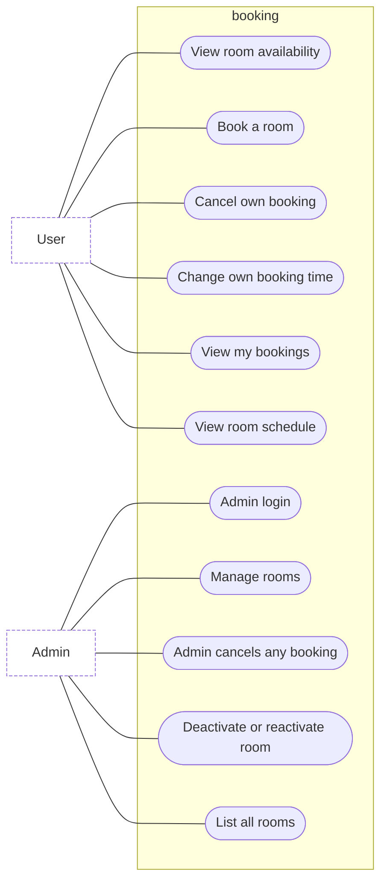

## Classes

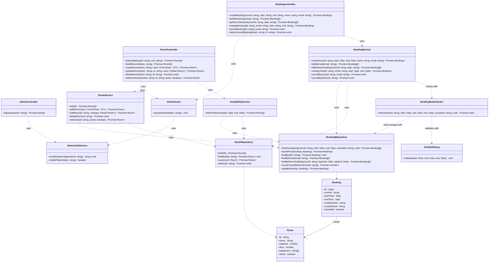

## Sequences

### SEQ-001 View room availability

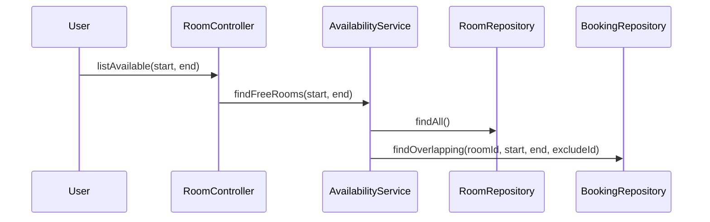

### SEQ-002 Book a room

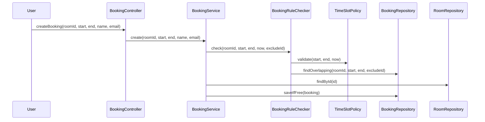

### SEQ-003 Cancel own booking

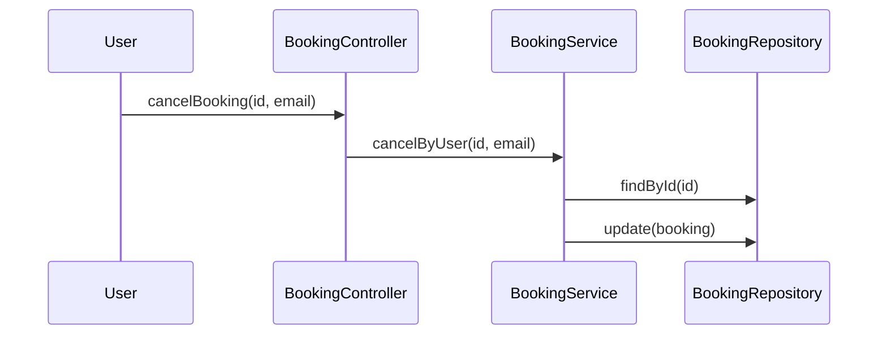

### SEQ-004 Change own booking time

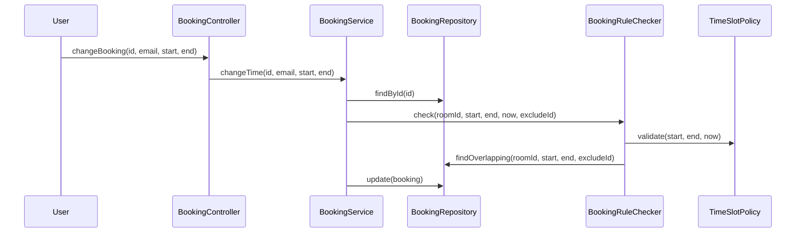

### SEQ-005 Admin login

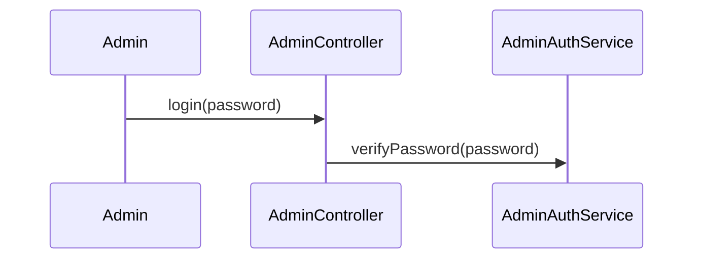

### SEQ-006 Manage rooms

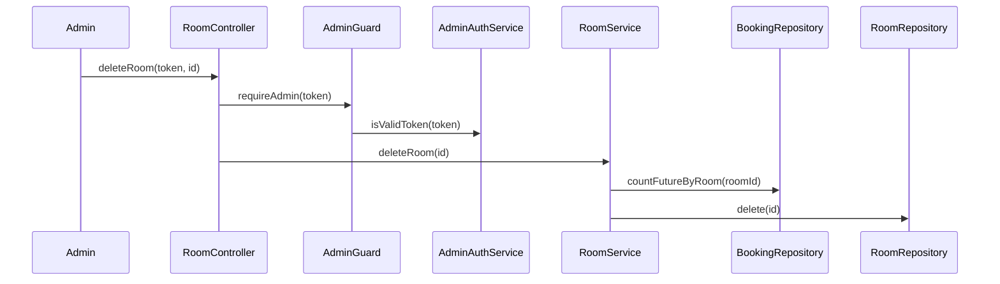

### SEQ-007 Admin cancels any booking

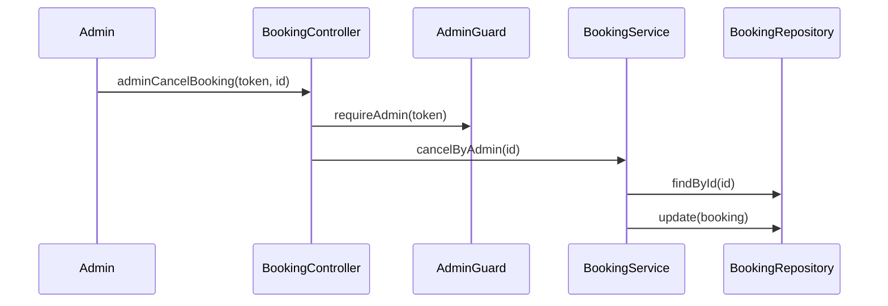

### SEQ-008 Deactivate or reactivate room

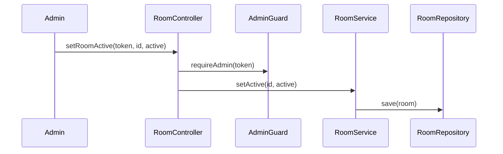

### SEQ-009 View my bookings

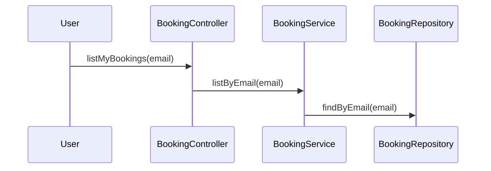

### SEQ-010 View room schedule

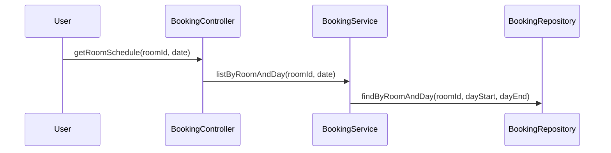

### SEQ-011 List all rooms

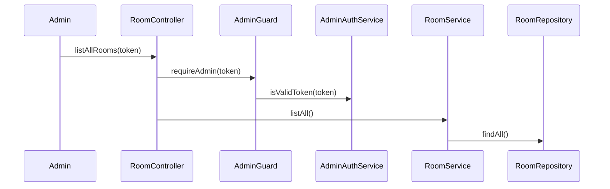

## Deployment

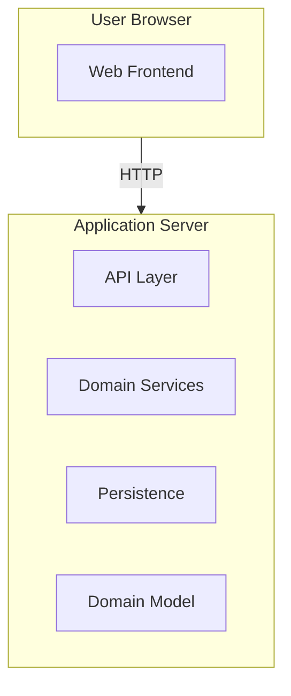

## Elements

- ACT-001 User (actor)
- ACT-002 Admin (actor)
- UC-001 View room availability (use case) (REQ-001, REQ-006)
- UC-002 Book a room (use case) (REQ-002, REQ-003, REQ-007, REQ-008, REQ-006)
- UC-003 Cancel own booking (use case) (REQ-004, REQ-008)
- UC-004 Change own booking time (use case) (REQ-010, REQ-003, REQ-007)
- UC-005 Admin login (use case) (REQ-009)
- UC-006 Manage rooms (use case) (REQ-005, REQ-009)
- UC-007 Admin cancels any booking (use case) (REQ-011, REQ-009)
- UC-008 Deactivate or reactivate room (use case) (REQ-012, REQ-009)
- UC-009 View my bookings (use case) (REQ-002, REQ-008, REQ-006)
- UC-010 View room schedule (use case) (REQ-002, REQ-006)
- UC-011 List all rooms (use case) (REQ-005, REQ-012, REQ-009)
- DSN-001 Room (class) (REQ-001, REQ-005, REQ-012)
- DSN-002 Booking (class) (REQ-002, REQ-003, REQ-004, REQ-008)
- DSN-003 RoomController (class) (REQ-001, REQ-005, REQ-012, REQ-009)
- DSN-004 BookingController (class) (REQ-002, REQ-004, REQ-010, REQ-011, REQ-009)
- DSN-005 AdminController (class) (REQ-009)
- DSN-006 AvailabilityService (class) (REQ-001)
- DSN-007 BookingService (class) (REQ-002, REQ-003, REQ-004, REQ-007, REQ-010, REQ-011, REQ-012)
- DSN-008 RoomService (class) (REQ-005, REQ-012)
- DSN-009 TimeSlotPolicy (class) (REQ-007, REQ-002)
- DSN-010 AdminAuthService (class) (REQ-009)
- DSN-011 RoomRepository (class) (REQ-001, REQ-005, REQ-012)
- DSN-012 BookingRepository (class) (REQ-003, REQ-001, REQ-002, REQ-004, REQ-005)
- DSN-013 AdminGuard (class) (REQ-009)
- DSN-024 BookingRuleChecker (class) (REQ-003, REQ-007, REQ-002, REQ-010)
- DSN-016 Web Frontend (component) (REQ-006, REQ-008)
- DSN-017 API Layer (component) (REQ-009, REQ-006)
- DSN-018 Domain Services (component) (REQ-007, REQ-003, REQ-009)
- DSN-019 Persistence (component) (REQ-003)
- DSN-023 Domain Model (component) (REQ-001, REQ-002, REQ-005, REQ-012)
- DSN-020 User Browser (client node) (REQ-006)
- DSN-021 Application Server (service node) (REQ-009, REQ-006, REQ-003)
- DSN-020 User Browser to DSN-021 Application Server (HTTP)
