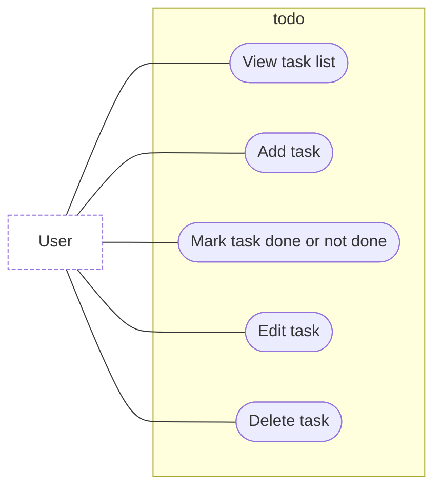
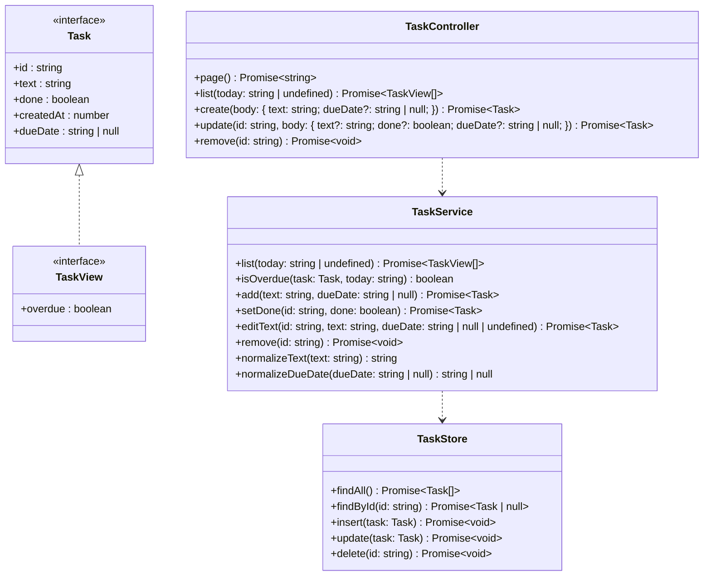
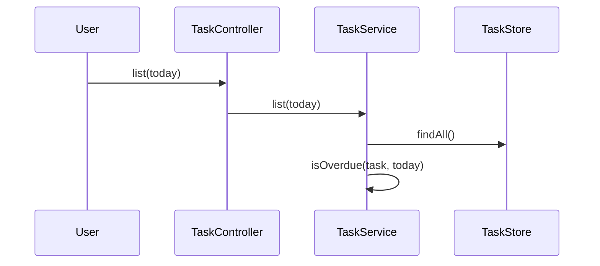
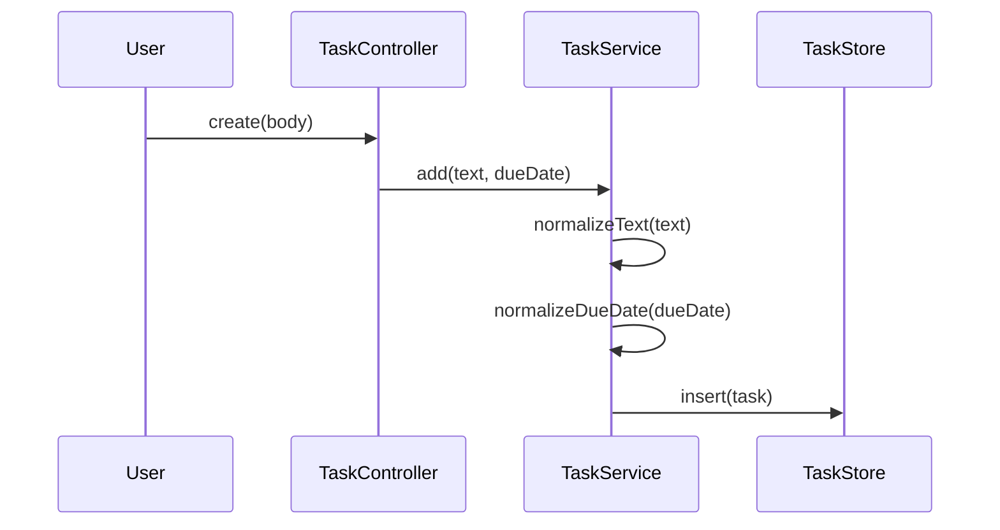
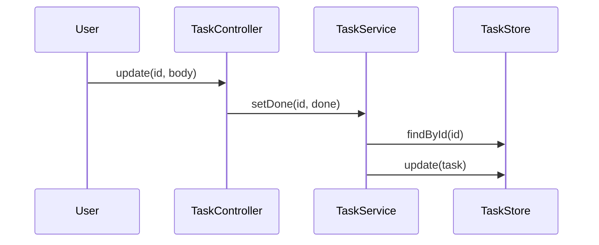
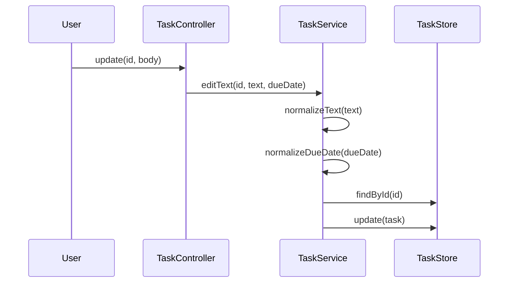
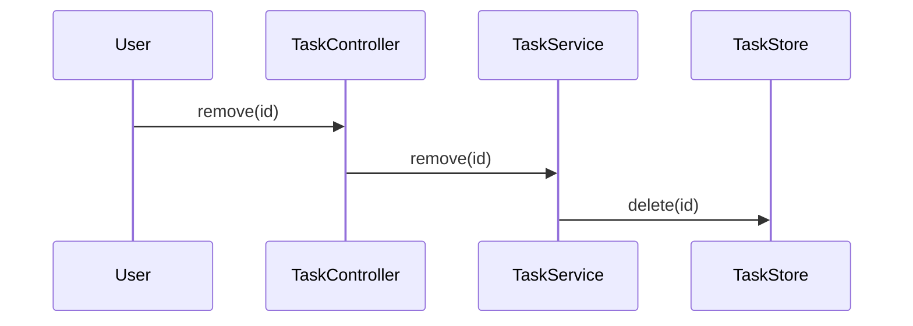
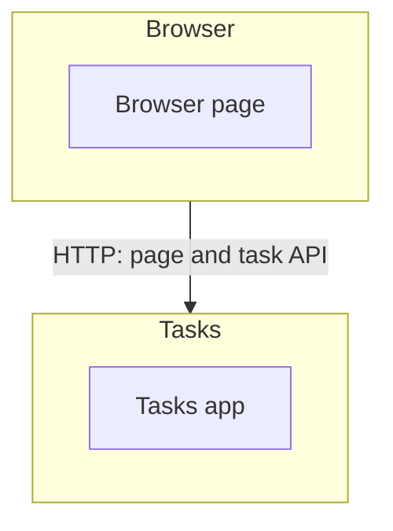

<!-- generated by AISE from .aise/*.json, do not edit -->

# todo: design

## Use cases

## Classes

## Sequences

### SEQ-001 View task list

### SEQ-002 Add task

### SEQ-003 Mark task done or not done

### SEQ-004 Edit task

### SEQ-005 Delete task

## Deployment

## Elements

- ACT-001 User (actor)
- UC-001 View task list (use case) (REQ-003, REQ-004, REQ-007, REQ-008, REQ-009, REQ-010)
- UC-002 Add task (use case) (REQ-001, REQ-003, REQ-009)
- UC-003 Mark task done or not done (use case) (REQ-002, REQ-003, REQ-007, REQ-010)
- UC-004 Edit task (use case) (REQ-005, REQ-003, REQ-009)
- UC-005 Delete task (use case) (REQ-006, REQ-003)
- DSN-005 Task (interface) (REQ-001, REQ-002, REQ-007, REQ-009, REQ-010)
- DSN-009 TaskView (interface) (REQ-010)
- DSN-006 TaskController (class) (REQ-001, REQ-002, REQ-004, REQ-005, REQ-006, REQ-007, REQ-008, REQ-009, REQ-010)
- DSN-007 TaskService (class) (REQ-001, REQ-002, REQ-005, REQ-006, REQ-007, REQ-009, REQ-010)
- DSN-008 TaskStore (class) (REQ-003, REQ-006, REQ-009)
- DSN-003 Browser page (component) (REQ-004, REQ-007, REQ-008, REQ-002, REQ-001, REQ-005, REQ-009, REQ-010)
- DSN-004 Tasks app (component) (REQ-001, REQ-002, REQ-003, REQ-005, REQ-006, REQ-007, REQ-008, REQ-009, REQ-010)
- DSN-001 Browser (client node) (REQ-004)
- DSN-002 Tasks (service node) (REQ-003, REQ-004, REQ-008)
- DSN-001 Browser to DSN-002 Tasks (HTTP: page and task API)
